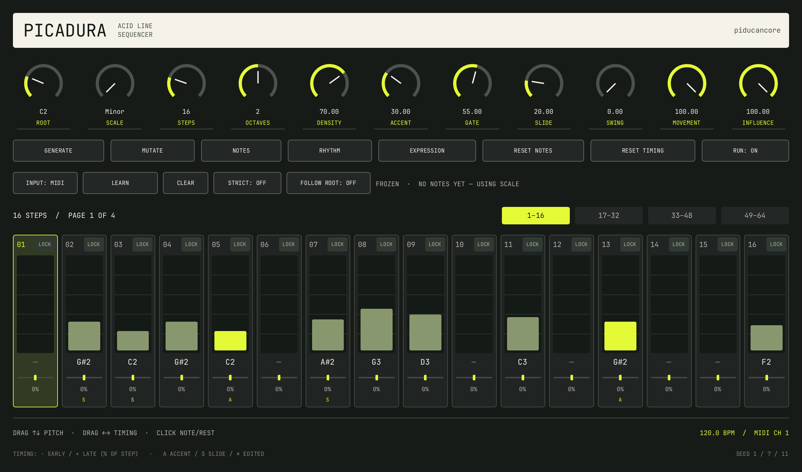

# Picadura

A 64-step acid-line MIDI sequencer by **piducancore**, built in Rust with Truce and a native Slint editor. The interface follows the typography, controls, and palette of Buffer Uppercut. This is an original implementation inspired by Sting's generative workflow, not a port of its Max patch.



## Play

Load Picadura on a MIDI track and start the host transport. It generates MIDI on channel 1; it does not generate audio.

**Ableton Live:** put your instrument on a second MIDI track. Set that track's MIDI From to Picadura's track, choose Picadura in the lower selector, and enable Monitor In. Live does not place VST MIDI generators before instruments in its native MIDI-effect chain.

**REAPER:** Picadura can precede a synth in the same FX chain.

Enable the synth's mono legato/portamento for slides. Accents use velocity 120; ordinary notes use 78. Slides overlap notes; the receiving synth determines the glide sound.

## Editing

- **Steps:** choose any pattern length from 1 to 64. Four page buttons show steps 1–16, 17–32, 33–48, and 49–64. Changing pages does not change playback or pattern length; steps outside the selected length are dimmed.
- **Drag vertically on a step:** change its absolute MIDI pitch, one semitone per six pixels. Dragging a rest creates a note. Manual pitches can be outside the selected scale.
- **Drag horizontally on a step:** change its trigger timing. Left plays earlier; right plays later. The first movement locks the gesture to pitch or timing until release, preventing accidental changes to the other axis.
- **Click a step:** toggle note/rest. Dragging does not toggle the note.
- **Timing range:** −25% to +25% of a sixteenth note, independent for all 64 steps. At 120 BPM this is ±31.25 ms. Offsets follow tempo and are saved and automatable. They move the MIDI trigger, not an audio delay effect.
- **Generate:** regenerate pitch, rhythm, and expression. The three adjacent buttons regenerate only their named lane. Manual pitches/rests and timing edits survive generation.
- **Reset Notes / Reset Timing:** restore generated pitches/rests or zero timing across all 64 steps.
- **Run:** mute/resume the generator while the host keeps playing.

Root is shown as a note name (MIDI 36 = C2). Six scales, 1–3 octaves, density, accent probability, gate length, slide probability, and swing remain available. `A` marks an accent, `S` a slide, and `*` a manual pitch/rest or timing edit.

## Timing and persistence

The pattern follows the host beat position. Early notes are scheduled before their nominal grid boundary, including before pattern wraps, without adding plugin latency. Gate durations follow the interval between shifted onsets; slides overlap the following shifted note. Offset limits preserve note order even at maximum swing.

Starting playback or seeking after an early note's trigger does not play it retroactively. A negative offset on the very first step cannot sound before the host starts; it is heard on later cycles. Stop, seek, mute, and reset release tracked notes.

All controls, 64 note overrides, 64 timing offsets, and generation seeds save with the DAW project and host presets. Page selection is an editor view only. The display vendor is `piducancore`; the original plugin identifiers are retained so existing Picadura instances can resolve to the update.

## Build

Rust 1.92+, `cargo-truce` 6.3, and Xcode command-line tools on macOS:

```sh
cargo test --lib --features rt-paranoid
cargo clippy --lib --tests -- -D warnings
cargo truce build
cargo truce install --user --no-build
```

Bundles: `target/bundles/Picadura.vst3` and `target/bundles/Picadura.clap`.

```sh
cargo truce screenshot --debug --out target/screenshots/picadura-slint.png
clap-validator validate target/bundles/Picadura.clap
```

The release profile disables symbol stripping to avoid the Rust 1.97 Mach-O alignment bug on macOS 27. Packaged release bundles are validated separately.

## Implementation

- `src/engine.rs`: deterministic 64-step generation and allocation-free beat-based scheduling.
- `src/params.rs`: stable host parameters, note overrides, timing offsets, and persistence.
- `src/ui.rs`: automation-safe Slint bindings and per-frame parameter snapshots.
- `ui/main.slint`: responsive controls, pages, and axis-locked drag gestures.
- `src/lib.rs`: Truce MIDI and audio integration.
- `vendor/truce-clap`: a narrow state-load host-notification fix; see `vendor/README.md`.

Tests cover exact early/late MIDI timestamps, 64-step wraparound, tempo/swing/slide interaction, block-size independence, note cleanup, and actual Slint pointer events. With `rt-paranoid`, the 64-step engine is also checked for audio-thread allocation. Validation records are kept under `target/validation`.

No hosted synth, audio synthesis, MIDI-file export, Push integration, or internal pattern bank is included.

## Verified build: 0.2.0

- 14 tests passed, including pointer drags and the real-time allocation check.
- Clippy and formatting checks passed.
- VST3 passed pluginval strictness 5, including Slint editor and state recall.
- CLAP: 37 checks passed, 7 skipped; no failures or warnings.
- Default Slint layout rendered and visually checked.

## Downloads and automated releases

Website: https://piducan.dev/picadura/

Source and releases: https://github.com/piducancore/picadura

GitHub Actions builds and validates Windows x64, macOS arm64, and Linux x64
packages. Version tags create draft prereleases with checksums; published
releases appear on the Astro download site. See [publishing](docs/releases/README.md)
and [website development](site/README.md).

Original code is MIT; third-party notices and the bundled font license ship
with every package.

### Scale choices

The Scale knob offers 16 choices: Minor (natural), Dorian, Phrygian, Major,
Pentatonic (minor), Chromatic, Lydian, Mixolydian, Locrian, Harmonic Minor,
Melodic Minor (ascending), Major Pentatonic, Blues (minor), Whole Tone,
Diminished Whole–Half, and Diminished Half–Whole. Explicit step-note edits
remain independent of the scale.

### Movement, mutation and locks

- **Movement**: 0 repeats the root; low values favor repeated and nearby scale
  degrees; 100 retains the original independent pitch/octave choices. Defaults
  to 100 so older projects retain their generated contour. Manual notes remain
  independent of the contour.
- **Mutate**: changes the pitch of a quarter of the currently sounding, unlocked
  steps (rounded up), across the entire active pattern. Rhythm, accents, slides,
  timing, and unselected notes stay unchanged. Lower Movement favors nearby
  replacement pitches. Mutations become editable note overrides; Reset Notes
  returns unlocked notes to generation. An entirely silent or locked pattern
  is a no-op.
- **Lock / Held** on each step: snapshots its pitch, note/rest state, accent and
  slide flag. Held steps survive generation and mutation; direct note/timing
  edits and resets skip them. Click Held to release the snapshot and resume the
  underlying generated/edited step. Locks and Movement are saved with the DAW
  project. Global gate and swing still apply; shortening the pattern silences
  locked steps outside its active length.
